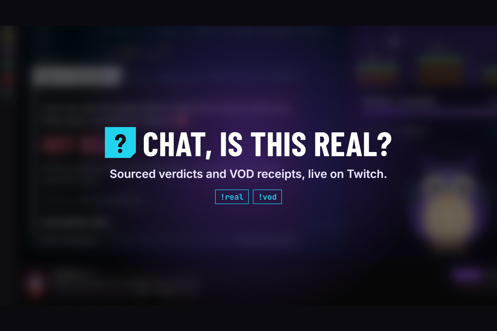
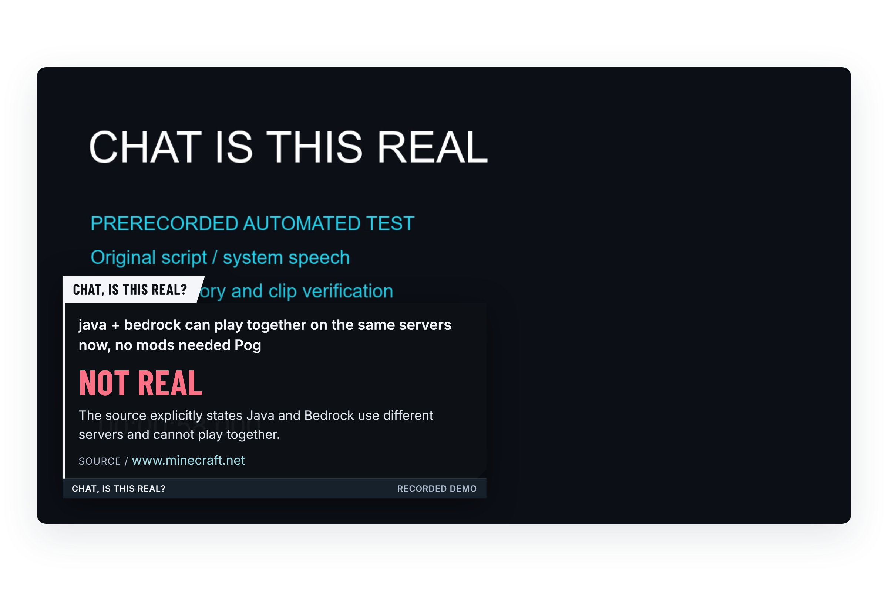
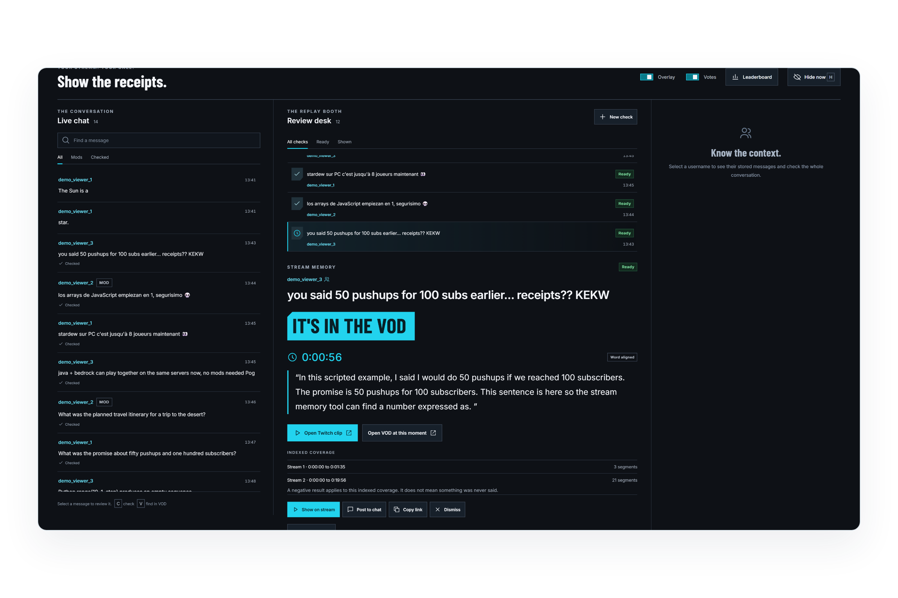
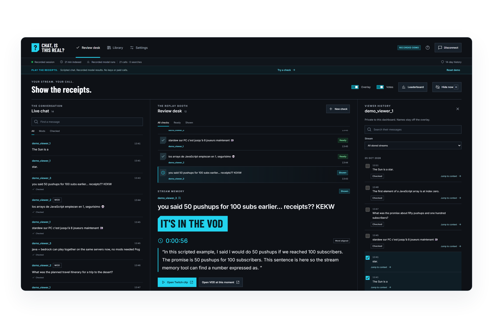
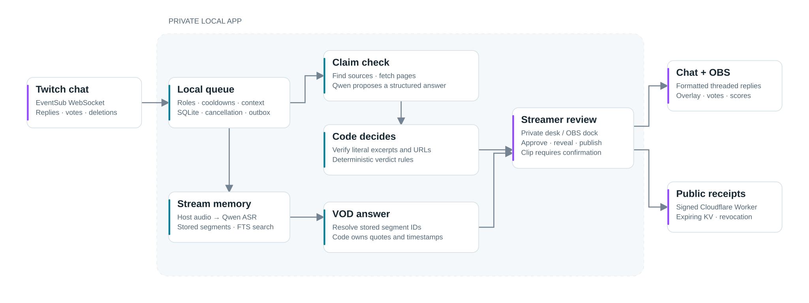

# Chat Is This Real



   

**Sourced checks and stream memory for Twitch streamers and their communities.**

I turn chat's claims and “you said that earlier” moments into evidence the streamer can review, reveal and replay.

| Open it | Where |
|---|---|
| Recorded demo, no keys | [Play online](https://chat-is-this-real.pages.dev/demo/) · [Project site](https://chat-is-this-real.pages.dev/) · [Local quickstart](#quickstart) |
| Launch film and submission assets | [Submission package](docs/SUBMISSION.md) |
| Built with OpenAI Codex | [Session, milestones and PRs](docs/BUILT_WITH_CODEX.md) |
| Final measurement | 23/24 heldout verdicts; 0 reversed verdicts; [full reports](docs/final-evaluation.md) |

## For judges

| Criterion | Evidence | Film |
|---|---|---|
| Innovation / Idea | A sourced verdict, a chat vote and a retrievable stream promise share one review flow. [Design](docs/dashboard.md). | 0:00–0:53 |
| Potential Impact | Viewer context, an approval hold and a real earlier-moment clip. [Twitch evidence](docs/vod-engine.md). | 0:53–1:49 |
| Technological implementation | [Verification](src/check/verify.ts), [verdict rules](src/check/verdict-rules.ts), [locked evaluation](eval/LOCK.md), [Codex build](docs/BUILT_WITH_CODEX.md). | 2:17–2:41 |
| Design | [Responsive desk and dock](docs/dashboard.md), [overlay and votes](docs/overlay.md), [multilingual examples](docs/showcase.md). | 1:49–2:17 |

## See it work





## The problem

A streamer is playing, talking and reading chat at once. A confident claim needs a source.
A promise from earlier needs a timestamp. Searching breaks the pace, and a bare model answer
gives chat little to inspect. I keep the conversation on stream: check the claim, let chat
vote, review the receipt, then reveal it. For stream memory, I return the stored words and
the moment they came from. The [recorded Twitch test](docs/vod-engine.md) found a promise
from earlier in the same broadcast and produced a playable clip.

## How it works



**The model proposes. The code decides. The streamer approves.**

EventSub messages enter a bounded local queue. Triage routes claims, questions and stream-memory
requests. A claim check fetches sources, asks Qwen for structured evidence, verifies each
excerpt against the fetched text and applies the table below. The private desk controls
publication. Stream memory resolves model-selected IDs against stored transcript segments;
code renders their quote, time and Twitch links.

| Verified evidence | Final verdict |
|---|---|
| Support, with no contradiction | REAL |
| Contradiction, with no support | NOT REAL |
| Both directions, or a proposed qualification supported by context | MISSING CONTEXT |
| No usable evidence | UNCONFIRMED |

The proposal cannot authorize a directional verdict without eligible verified evidence.
Verbatim verification establishes literal presence; interpreting the passage remains a model task.

## Built with OpenAI Codex

Main build session: **`01a16cc3-1a5e-7d23-81c2-c9de487cc7fd`**.

I gave Codex the milestone plan, [AGENTS.md](AGENTS.md), project skills and explicit review
rules. It implemented the Twitch adapters, checking pipeline, stream memory, UI, browser
demo, tests and submission tools in successive PRs. [The milestone table](docs/BUILT_WITH_CODEX.md)
links the code, manual audit findings and observed checks. Each milestone requested a GitHub
Codex review; the table distinguishes those requests from observed review evidence.

The film includes actual footage of the supplementary CLI session reading the project
instructions, followed by the real retrieval diff and recorded build output. A source
regression caught a short-token bug: dropping “PC” and “8” lost the relevant Stardew passage.
The [mutation probe](eval/results/hardening-mutation-2026-10-25T08-49-26-634Z.json) restored
the earlier implementation, observed that regression fail and restored the passing bytes.

## Runtime services

| Purpose | Model or service | Measurement |
|---|---|---|
| Claim triage | Qwen `qwen3.8-flash`, Alibaba Cloud Model Studio | [Repeated probe timings](docs/models.md) |
| Source discovery | Curated URL replay by default; optional Model Studio search | [Discovery scope](docs/check-engine.md) |
| Evidence proposal | Qwen `qwen3.8-max` | [Final end-to-end measurements](docs/final-evaluation.md) |
| VOD segment selection | Qwen `qwen3.8-flash` | [Repeated VOD measurements](docs/vod-engine.md) |
| Primary transcription | `qwen-audio-3.1-asr-flash` | [Original system-speech probe](docs/models.md) |
| Speech fallback | `qwen3-asr-flash` | [Fallback and timing scope](docs/vod-engine.md) |
| Private state | SQLite; Node locally, SQLite WASM in the static demo | [Browser architecture](docs/demo.md) |
| Public pages | Cloudflare Workers and KV, signed publication and expiring receipts | [Setup and removal](docs/public-pages.md) |

| Twitch surface | Implementation |
|---|---|
| EventSub over WebSocket | Chat, replies, votes, message/user/stream clears; reconnect and watchdog. |
| Send Chat Message | Code-formatted, threaded replies with an outbox and live-stream checks. |
| Clip From VOD | A confirmed earlier moment in the broadcaster’s archive. |
| Live clip fallback | A bounded eligible recent moment, with explicit fallback handling. |
| Get Videos | Match the archive to its broadcast and import owned VOD transcripts. |
| Get Channel Information | Channel context for the private session. |
| OBS browser source | Transparent overlay at `/overlay`. |
| OBS custom browser dock | The same review desk in a narrow responsive layout. |

## Safety

The streamer reviews results before publishing. There are no automatic penalties.
Moderation clears source text and cancels dependent checks; published receipts enter a
persistent removal queue. Chat, transcripts and pages enter labelled JSON as untrusted data.
Public projections verify stored source hashes and excerpts again, redact account handles,
and apply the loaded-secret guard. Every outgoing chat message passes the shared formatter.
The local dashboard uses loopback, origin checks and a session header for mutations.

## Evidence

| Final frozen run | Verdict agreement | Reversed verdicts | Verified / proposed excerpts | p50 / p90 |
|---|---|---|---|---|
| Dev, 48 inputs | 45/48 | 0 | 43/43 | 5.67 s / 7.65 s |
| Heldout, 24 inputs, run once | 23/24 | 0 | 19/20 | 5.26 s / 6.02 s |

These small authored splits share related source pages. Search discovery is simulated with
curated URLs; fetching and model inference are live. Timings include non-claims and guards,
and exclude paid discovery. [Final reports and provenance](docs/final-evaluation.md) retain
every output, including the rejected heldout excerpt. [The latency chart](docs/figures/latency.svg)
and [evaluation tiles](docs/figures/evaluation.svg) regenerate from those reports.

`npm run eval:verify` checks the locked corpus. `npm run eval:freeze -- --verify` checks the
final engine in the configured environment. The heldout reservation is permanent. Use a
new development run for later experiments; retain the original result. Live-path repetitions,
speech, VOD retrieval and actual Twitch probes are linked in the milestone log.

### Claims a reviewer can trace

| Claim | Code | Test |
|---|---|---|
| Public excerpts come from verified source text. | [verify](src/check/verify.ts), [projection](src/server/public-result.ts) | [evidence](tests/evidence.test.ts), [projection routes](tests/public-projection-routes.test.ts) |
| Final verdicts follow verified evidence. | [rules](src/check/verdict-rules.ts), [proposal](src/check/proposal.ts) | [verdict rules](tests/verdict-rules.test.ts) |
| The model cannot invent a public VOD timestamp or quote. | [answer](src/vod/answer.ts) | [VOD](tests/vod.test.ts) |
| Replies require the active owned stream and an eligible source. | [publisher](src/twitch/publisher.ts) | [publication guards](tests/publication-guards.test.ts) |
| Commands, mentions and loaded secret fragments are guarded. | [formatter](src/shared/format-chat.ts) | [formatting](tests/format-chat.test.ts), [red team](tests/red-team-routes.test.ts) |
| Deletion clears copied source text and dependent publication. | [chat core](src/twitch/chat-core.ts), [public publisher](src/server/public-publisher.ts) | [chat core](tests/chat-core.test.ts), [public pages](tests/public-pages.test.ts) |
| The first eligible vote counts once; scores follow the revealed verdict. | [tally](src/votes/tally.ts) | [votes](tests/votes.test.ts), [recorded votes](tests/recorded-votes.test.ts) |
| Desk, overlay and SQLite agree. | [presentation](src/server/presentation-control.ts) | [real-browser walkthrough](e2e/walkthrough.spec.ts) |
| Public receipt replay and purge races are guarded. | [Worker](worker/index.ts), [publisher](src/server/public-publisher.ts) | [public pages](tests/public-pages.test.ts), [Worker browser](e2e/public-pages.spec.ts) |
| The static demo shares the production domain code. | [browser worker](web/demo/host.ts) | [static demo](e2e/static-demo.spec.ts) |

Real Twitch frames, model responses and source captures were recorded from the services;
the keyless demo replays verified outcomes with fictional chat accounts and scripted voters.

### Limits

Qualification and stance interpretation can still be wrong, so approval is essential.
Default free search replay covers its catalogue; other claims fail privately until live
discovery is configured. Speech measurements use the original prerecorded system narration.
The live vote probe observed one eligible real voter; the three-viewer flow uses scripted
browser voters. The [public demo](https://chat-is-this-real.pages.dev/demo/) uses free static
Pages hosting. Signed receipt hosting requires separately verified Free-plan configuration.
Video upload and repository access are recorded in [the handoff](HANDOFF.md).

## Quickstart

Use Node.js 24 LTS, then:

```sh
npm ci
npm run demo
```

Open [localhost:4747](http://localhost:4747/). Choose a recorded example, inspect its evidence,
start a check, cast the scripted votes and approve the reveal. Open `/overlay` beside it.
The demo runs in memory and needs no keys. On Windows, use `npm.cmd` if PowerShell blocks
`npm.ps1`. [Docker instructions](docs/container.md) provide the same recorded demo.

For the connected app, copy `.env.example` to `.env`, complete [Twitch setup](docs/setup-twitch.md),
configure Model Studio and start `npm run dev`. Keep paid search disabled unless you choose
to enable its billing. Use `npm run companion -- --list` to select host audio, then run the
companion during your stream. Add `http://localhost:4747/overlay` as an OBS browser source
and the root URL as a custom browser dock. [Public receipt setup](docs/public-pages.md)
connects reviewed links after deployment.

```sh
npm run typecheck
npm run lint
npm test
npm run test:e2e
npm run worker:check
```

### Layout and licence

`src/` holds Twitch, checking, stream memory, voting, storage and the local server.
`web/` holds the desk, overlay, launch page and shared browser demo. `companion/` captures
host audio. `worker/` serves public receipts. `eval/` holds locked data and measurements.
`fixtures/` holds recorded service data. `film/` and `scripts/` contain editable production tools.

[MIT licence](LICENSE) · [Privacy and removal](docs/PRIVACY.md) · [Gallery captions](CAPTIONS.md)
