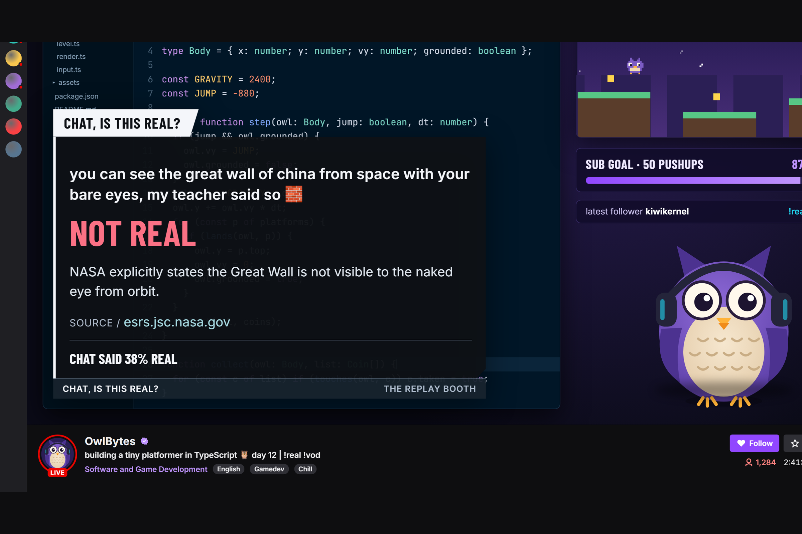
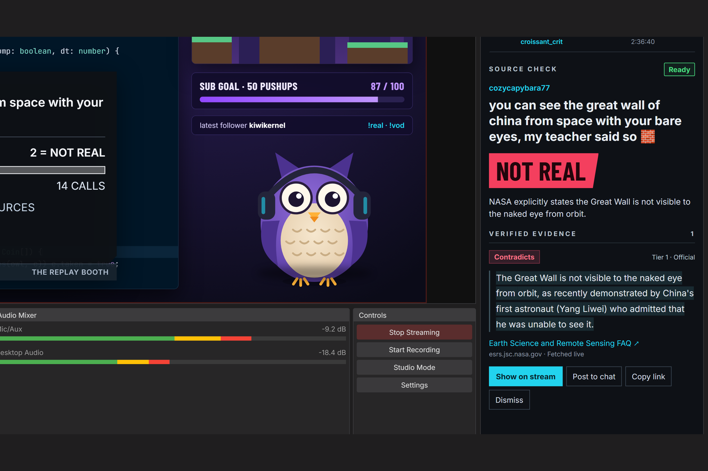
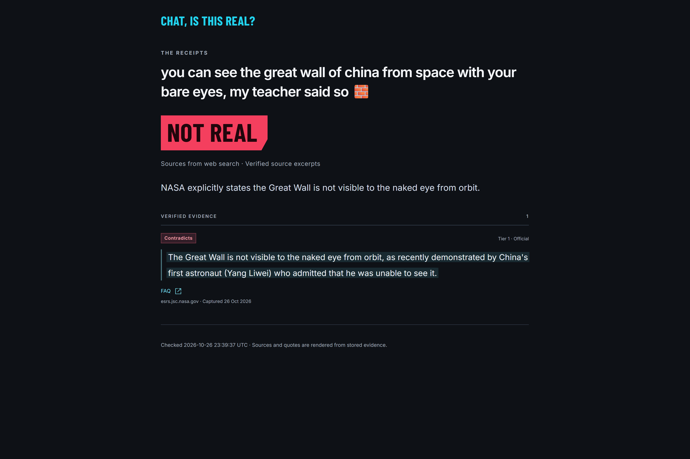
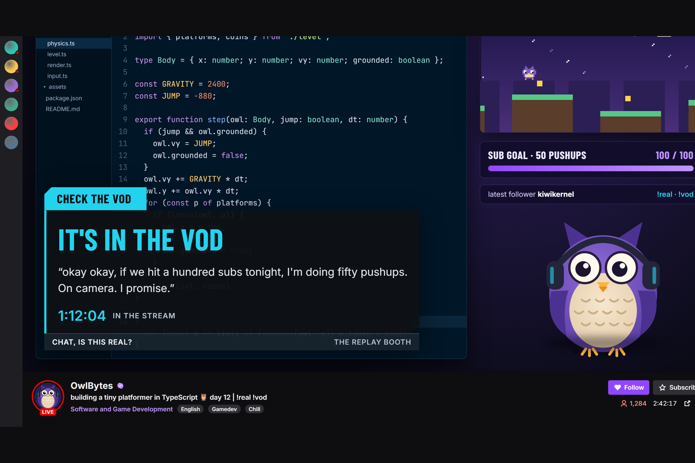

# Chat Is This Real



   

**A Twitch bot, OBS overlay and review desk that turns "chat, is this real?" into a sourced verdict on stream, and "you said that earlier" into a clip.**

I audit bank systems for a living. Nothing goes in my report without evidence in the file. Chat Is This Real holds chat to the same rule.

| | |
|---|---|
| Try it, no account | [chat-is-this-real.pages.dev/demo](https://chat-is-this-real.pages.dev/demo/) |
| Built with | [OpenAI Codex](docs/BUILT_WITH_CODEX.md), session `01a16cc3-1a5e-7d23-81c2-c9de487cc7fd` |
| Runs on | Twitch EventSub, Send Chat Message, Clip From VOD, OBS, Qwen on Alibaba Cloud Model Studio |
| Headline | 23/24 heldout verdicts, 0 REAL/NOT REAL swaps ([evaluation](docs/evaluation.md)) |

## For judges

| Criterion | Where to look | Film |
|---|---|---|
| Innovation | Chat's two catchphrases become commands: `!real` for a sourced verdict while chat votes, `!vod` for the clip of what the streamer said. [Overlay and votes](docs/overlay.md), [stream memory](docs/stream-memory.md) | 0:00–0:19, 1:08–1:31 |
| Potential impact | One reply from a mod, one click from the streamer, no tab switching. Works on any claim with free Wikipedia discovery. [Check engine](docs/check-engine.md) | 0:19–0:51 |
| Technological implementation | Verified excerpts and a four-row verdict table, a locked and frozen evaluation, recorded Twitch traffic in every test, 13 Codex PRs. [Evaluation](docs/evaluation.md), [Built with Codex](docs/BUILT_WITH_CODEX.md) | 0:36–0:51, 1:45–2:23 |
| Design | Replay-booth overlay, review desk in a 380 px OBS dock, receipts chat can open. [Review desk](docs/dashboard.md), [receipts](docs/public-pages.md) | 0:51–1:08 |

## See it work





## The problem

Twitch chat sent 45 billion messages in 2025 ([Twitch 2025 Recap](https://www.tubefilter.com/2025/12/03/twitch-year-end-recap-2025-900-million-hours-watch-time/)).
Some of them are confident claims, and the whole room wants to know if they are true. Checking
one live means leaving the stream for a search bar while chat waits. The other classic moment,
"you said that earlier", means scrubbing the VOD by hand.

## How it works


**The model proposes. The code decides. The streamer approves.** The model classifies a message,
writes search queries and proposes a verdict with excerpts. Code fetches every source, keeps only
excerpts found word for word on the page, derives the final verdict from the verified evidence,
and renders every quote, timestamp, link and clip from stored data.

| Verified evidence | Final verdict |
|---|---|
| Supports, with no contradiction | REAL |
| Contradicts, with no support | NOT REAL |
| Both directions, or a qualification the model proposed with supporting context | MISSING CONTEXT |
| Nothing verified | UNCONFIRMED |

1. A mod replies `!real` to a chat message. EventSub delivers it; the queue checks roles,
   cooldowns and context from the same viewer.
2. Triage, discovery, fetching, the evidence proposal, verification and the verdict table run in
   about 5 seconds (p50).
3. The overlay opens a vote, **CHAT, IS THIS REAL? 1 = REAL · 2 = NOT REAL**, for 20 to 60 seconds.
4. The streamer reviews the source on the desk and clicks **Show on stream**. The stamp lands with
   chat's split, the bot replies in the thread with a receipt link, and correct callers score.
5. `!vod` searches the stream's stored transcript, returns the quote and its time, and cuts a
   clip with Create Clip From VOD.

## Built with OpenAI Codex

I built the project in one Codex thread in VS Code, session **`01a16cc3-1a5e-7d23-81c2-c9de487cc7fd`**:
13 milestone pull requests, 46 commits, 769 commands and 124 tests at the final milestone.
Codex worked from my 12-milestone plan, [AGENTS.md](AGENTS.md) and six project skills in
[`.agents/skills/`](.agents/skills). [The milestone log](docs/BUILT_WITH_CODEX.md) links every PR
and the proof each one merged with.

## Runtime services

| Purpose | Service | Measurement |
|---|---|---|
| Triage | `qwen3.8-flash`, Alibaba Cloud Model Studio (Singapore) | 30/30 kinds, p50 2.04 s ([models](docs/models.md)) |
| Evidence proposal | `qwen3.8-max` | 22/22 returned excerpts verified in the probe |
| Source discovery | Wikipedia search (free) or Model Studio web search (`SEARCH_MODE`) | [Check engine](docs/check-engine.md) |
| Stream memory | `qwen3.8-flash` picks segment IDs; code renders the quote | 20/20 moments within ±15 s |
| Transcription | `qwen-audio-3.1-asr-flash`, word timestamps | 12 word errors in 606 words |
| Public receipts | Cloudflare Workers and KV, [receipts.chatisthisreal.workers.dev](https://receipts.chatisthisreal.workers.dev/) | 3/3 published, removal verified ([receipts](docs/public-pages.md)) |
| Demo | Static Cloudflare Pages, SQLite WebAssembly in the browser | [Demo](docs/demo.md) |

| Twitch surface | Use |
|---|---|
| EventSub over WebSocket | Chat, replies, deletions, user and chat clears, stream online/offline |
| Send Chat Message | Threaded replies with the app token and the Chat Bot badge |
| Create Clip From VOD | The clip of the earlier moment, from the in-progress archive |
| Get Videos, Get Streams, Get Channel Information | Archive matching, stream time, category for triage |
| OBS Browser Source and Custom Browser Dock | The overlay at `/overlay` and the desk at 380 px |

## Safety

- The streamer approves every reveal. Sensitive claims need a second confirmation.
- Instruction attacks end as "not a claim" before any model call: 0 directional verdicts on 10 injections.
- Deleting a message cancels every check and receipt built on it.
- Chat, pages and transcripts reach the model as labelled data. No model-written link, username
  or command reaches chat, and every message passes a formatter that blocks secret fragments.
- No automatic bans or penalties. Usernames stay off the overlay and the receipts.

## Evidence

| Run | Verdict agreement | Swapped REAL / NOT REAL | Verified / returned excerpts | p50 / p90 |
|---|---|---|---|---|
| Dev, 48 inputs | 45/48 | 0 | 43/43 | 5.67 s / 7.65 s |
| Heldout, 24 inputs, run once | 23/24 | 0 | 19/20 | 5.26 s / 6.02 s |
| Dev with free Wikipedia discovery | 32/48, every miss UNCONFIRMED | 0 | 27/32 | 6.69 s / 11.64 s |

The claim set was locked and hashed before the checker existed; the engine was frozen before the
heldout messages were opened. Source URLs for the locked runs came from web search; fetching,
inference and verification ran live. [Evaluation](docs/evaluation.md) has every report.

```sh
npm run eval:verify                                  # data matches its lock
LIVE=1 npm run eval -- --suite claims --split dev    # needs a Model Studio key
```

### Claims a reviewer can trace

| Claim | Code | Test |
|---|---|---|
| Public excerpts come from verified source text. | [verify](src/check/verify.ts), [projection](src/server/public-result.ts) | [evidence](tests/evidence.test.ts), [projection routes](tests/public-projection-routes.test.ts) |
| Final verdicts follow verified evidence. | [rules](src/check/verdict-rules.ts), [proposal](src/check/proposal.ts) | [verdict rules](tests/verdict-rules.test.ts) |
| The model cannot invent a public VOD quote or timestamp. | [answer](src/vod/answer.ts) | [VOD](tests/vod.test.ts) |
| Replies need the live owned stream and a verified source. | [publisher](src/twitch/publisher.ts) | [publication guards](tests/publication-guards.test.ts) |
| Commands, mentions and secret fragments are guarded. | [formatter](src/shared/format-chat.ts) | [formatting](tests/format-chat.test.ts), [red team](tests/red-team-routes.test.ts) |
| Deletion clears copied text and dependent receipts. | [chat core](src/twitch/chat-core.ts), [publisher](src/server/public-publisher.ts) | [chat core](tests/chat-core.test.ts), [public pages](tests/public-pages.test.ts) |
| One vote per viewer; points follow the revealed verdict. | [tally](src/votes/tally.ts) | [votes](tests/votes.test.ts), [recorded votes](tests/recorded-votes.test.ts) |
| Desk, overlay and SQLite agree. | [presentation](src/server/presentation-control.ts) | [walkthrough](e2e/walkthrough.spec.ts), [overlay votes](e2e/overlay-votes.spec.ts) |
| Free discovery finds Wikipedia articles from triage queries. | [discovery](src/check/search-wikipedia.ts) | [Wikipedia](tests/search-wikipedia.test.ts) |
| The browser demo runs the shipped domain code. | [demo host](web/demo/host.ts) | [static demo](e2e/static-demo.spec.ts) |

Twitch frames, model responses and source pages in `fixtures/` were recorded from the live
services; the demo plays recorded engine results with demo viewers.

## Quickstart

Node.js 24 LTS:

```sh
npm ci
npm run demo
```

Open `http://localhost:4747/` and `http://localhost:4747/overlay`. The demo needs no keys.
[Docker](docs/container.md) serves the same demo.

Connected to your channel: copy `.env.example` to `.env`, follow [Twitch setup](docs/setup-twitch.md),
add a Model Studio key, then `npm run dev`. Add `http://localhost:4747/overlay` as an OBS Browser
Source and `http://localhost:4747/` as a Custom Browser Dock. Run `npm run companion` for stream
memory, and [connect receipts](docs/public-pages.md) to give chat a link.

```sh
npm run typecheck && npm run lint && npm test && npm run test:e2e
```

## Layout

`src/twitch` EventSub, commands, publisher · `src/check` the check engine · `src/vod` stream memory ·
`src/votes` tally · `src/server` local app · `web/` desk, overlay, demo · `worker/` receipts ·
`companion/` audio capture · `eval/` locked data and reports · `fixtures/` recorded traffic.

[MIT licence](LICENSE) · [Privacy and removal](docs/PRIVACY.md) · [Gallery captions](CAPTIONS.md)
